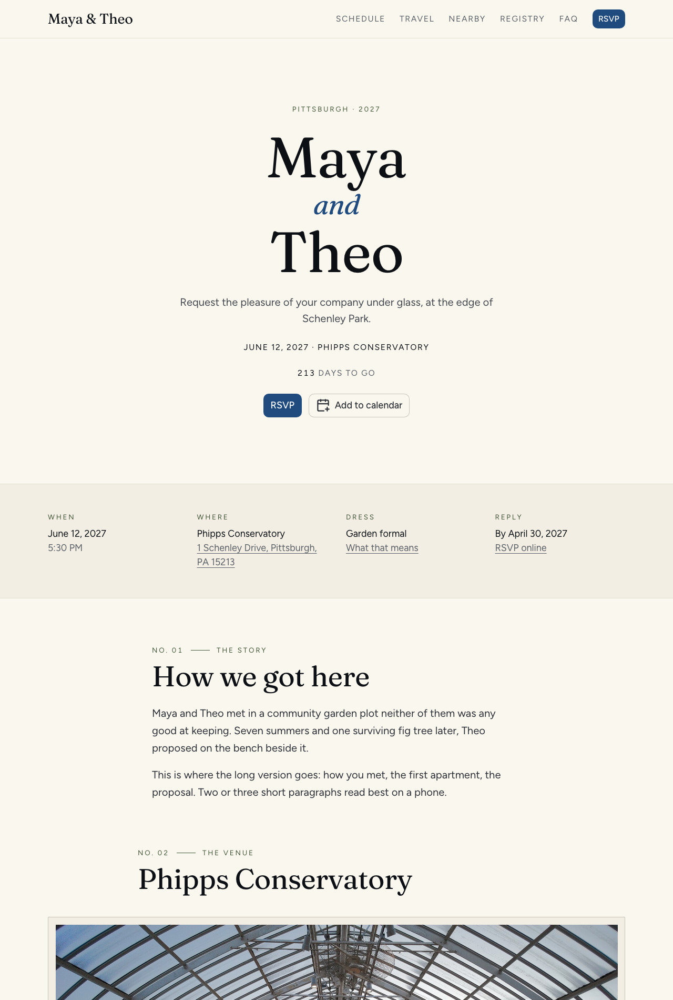

# nuxt-wedding-template

A wedding website you own: schedule, travel, registry, FAQ and a real RSVP system, running on
Cloudflare Workers' free tier. No ads, no upsells, no guest accounts.

**Demo:** https://nuxt-wedding-template.jeremy-ettlinger.workers.dev (a fictional couple; RSVP as
"Sam Lee" or "Ada Okafor").



## What guests get

- Every answer on a phone in under a minute: when, where, what to wear, where to stay.
- RSVP for the whole household without an account: a personal link or QR code from the
  invitation, or their name. Per-person answers per event, meal choice, dietary notes, a song
  request. They can come back and change answers until the deadline.
- Add-to-calendar for the whole weekend, private events included for those invited to them.
- A "today" view across the wedding weekend with the next event and directions.

## What the couple gets

- `/manage`: headcounts and meal counts per event, the guest list with search, bulk paste
  import, edit in place, CSV export for the caterer.
- Address collection for save-the-dates, printable address labels and QR cards.
- Optional email: RSVP confirmations, a notice per reply, one-click reminders.
- Two themes, and a design system to add your own.

Stack: Nuxt 4, NuxtUI, D1 (SQLite) via Drizzle, KV for rate limiting. The whole product is one
Nuxt layer, [`layers/wedding`](layers/wedding): [README](layers/wedding/README.md) ·
[product spec](layers/wedding/SPEC.md) · [design system](layers/wedding/DESIGN.md).

## Make it yours

```bash
bun install
bun run dev    # open http://localhost:3000/?wedding=mayatheo
```

1. Copy `layers/wedding/weddings/mayatheo.ts` to `<yourslug>.ts`, fill it in, and register it in
   `weddings/index.ts` in place of the sample. Everything a guest reads lives in that one file.
2. Put your photos in `public/weddings/<yourslug>/` and list them in the config (or leave
   `photos` empty; every page works without them).
3. Create an admin token for `/manage`: [README › Admin access](layers/wedding/README.md#admin-access).

It is built to be edited with a coding agent: `AGENTS.md` tells it where things are.

## Deploy

You need a free Cloudflare account and [bun](https://bun.sh).

```bash
bunx wrangler login
bunx wrangler d1 create my-wedding-db
bunx wrangler kv namespace create my-wedding-kv
```

Put the two ids those commands print into `wrangler.toml`, set `name` and `database_name` there
(and the database name in `package.json`'s `db:migrate:remote`), add your hostname to `hosts`
in your wedding config, then:

```bash
bun run deploy
```

That gives you `https://<name>.<your-subdomain>.workers.dev`. For your own domain, uncomment the
`[[routes]]` block in `wrangler.toml`. To turn on email, see
[README › Email](layers/wedding/README.md#email).

## License

MIT. The sample photographs are by Dllu, CC BY-SA 4.0, via Wikimedia Commons; credits are in
`layers/wedding/weddings/mayatheo.ts`.
